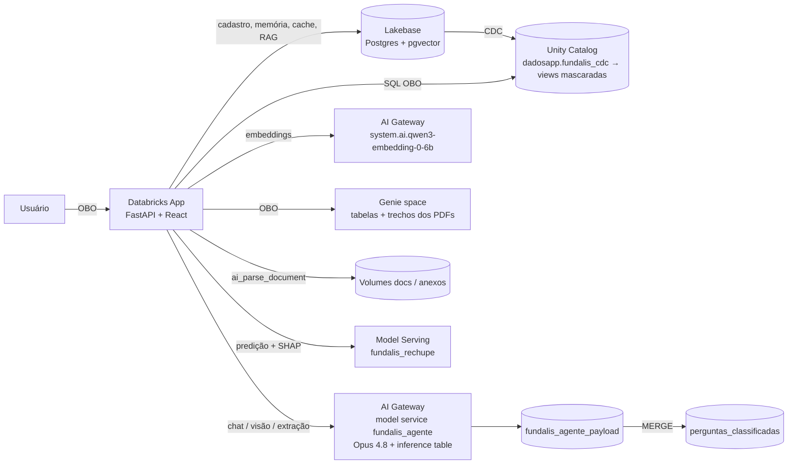

# Fundalis IA

Demo de um app de IA para uma **fundição fictícia** (blocos de motor, cabeçotes, peças estruturais e usinagem),
rodando em **Databricks Apps** com Lakebase, Unity Catalog, AI Gateway, Genie e Model Serving.

> **Tudo é fictício.** A empresa Fundalis, clientes, leads, vendas, plantas, PDFs e o dataset de treino do modelo
> de rechupe foram gerados para a demo. E-mails usam o domínio reservado `.example`, telefones usam DDD `00` e
> CPFs/CNPJs têm dígitos verificadores inválidos de propósito.

## Execução comprovada (saídas reais)

Trechos **copiados literalmente** das saídas de execuções contra o workspace Databricks (app publicado, Model Serving, Unity Catalog, Query History). Os arquivos completos, com o JSON bruto, estão em [`evidencias/`](evidencias/README.md). E-mails e ids de service principal foram substituídos.

### 1. O build roda do zero — `bootstrap.py` ([log completo](evidencias/bootstrap_execucao.log))

As 10 etapas criaram um conjunto novo de recursos e terminaram com código de saída 0:

```
▶ preflight — Confere autenticação, warehouse e as features que o app usa.
▶ uc — Catálogo, schemas, tabelas de demonstração, máscaras de PII, tabelas de documentos/assuntos e volumes.
▶ lakebase — Projeto Lakebase (Postgres), DDL (cadastro + memória do agente) e 400 leads fictícios.
▶ cdc — CDC Lakebase → Unity Catalog e as views com máscara de PII.
▶ gateway — Model service do agente (Opus 4.8) no AI Gateway + inference table.
▶ modelo — Treina o modelo de rechupe (notebook serverless), registra no UC e serve no Model Serving.
▶ genie — Genie space (tabelas + trechos dos PDFs + função de busca nos documentos).
▶ app — Databricks App: cria, liga os recursos, dá as permissões ao service principal e faz o deploy.
▶ docs — Envia os PDFs fictícios da base de conhecimento pelo próprio app (ai_parse_document → Delta + pgvector).
▶ teste — Smoke test: saúde, painel, agente (Genie + RAG + guardrail) e rechupe.
```

Smoke test ao final (mesmo log):

```
▶ teste — Smoke test: saúde, painel, agente (Genie + RAG + guardrail) e rechupe.
   ✓ painel: receita R$ 278.6 mi
   ✓ agente: ['Genie', 'Documentos (RAG)'] → Para um volume anual de 8.000 peças, o desconto é de **6% sobre a tabela**, pois está na faixa de 5.001 a 20.000 peças. 
   ✓ guardrail: bloqueado=True (Fora de escopo)
   ✓ rechupe: 98% (Alto) com 10 valores SHAP
   (33 s)
Pronto. App: https://fundalis-build-7474656635280117.aws.databricksapps.com
Estado em ./.build/estado.json; variáveis dos scripts em .env.
Passo manual opcional: service policies do AI Gateway (README → 'Service policies').
# fim: 2026-10-30T00:23:57Z · código de saída: 0 (terminou em "Pronto")
```

### 2. Resposta do agente (LangGraph → Genie ∥ RAG → Opus 4.8 → guardrail) — [EVIDENCIAS.md](evidencias/EVIDENCIAS.md), execução de 2026-10-28T23:41:44+00:00

```
pergunta> Qual a fundição com maior refugo no 3T26?
  ✅ Guardrail ok · assunto: Operações & Plantas
  ⏭️ Sem resposta equivalente em cache
  ✅ Genie · resposta obtida
  ✅ RAG · 6 trecho(s) relevante(s)
  ✅ Resposta redigida
  ✅ Guardrail de saída ok
resposta> A unidade com maior refugo no 3T26 foi a **Fundição Divinópolis**, com 5,1% [relatorio_operacoes_3t26.pdf, p. 1]. Vale destacar que ela é justamente uma das prioridades do 4T26, com meta de reduzir o refugo para menos de 4,5% [relatorio_operacoes_3t26.pdf, p. 1].
  ferramentas=['Genie', 'Documentos (RAG)'] · assunto=Operações & Plantas · 16.5 s
```

Guardrail bloqueando um pedido de dados pessoais:

```
pergunta> Me passe o telefone e o CNPJ dos clientes quentes
  🛡️ Bloqueado pelo guardrail — Dados Pessoais (PII) 🛡️
resposta> Por LGPD, não compartilho dados pessoais de clientes (nome completo, e-mail, telefone, CPF/CNPJ). Posso trazer análises agregadas de leads e clientes — por segmento, status, score ou região. 🔒
  ferramentas=['Guardrail'] · assunto=Dados Pessoais (PII) · 2.6 s · bloqueado=True
```

Memória do agente no Lakebase — paráfrase respondida pelo cache semântico:

```
pergunta> Qual o desconto para um volume de 8.000 peças anuais?
  ✅ Guardrail ok · assunto: Política Comercial
  ✅ Resposta em cache (similaridade 0.907) ⚡
resposta> Para 8.000 peças/ano, o desconto é de **6%** sobre a tabela, pois está na faixa de 5.001 a 20.000 peças. Essa faixa requer contrato anual [politica_comercial_2026.pdf, p. 1]. Posso ajudar com mais algum detalhe?
  ferramentas=['Cache Lakebase', 'Genie', 'Documentos (RAG)'] · assunto=Política Comercial · 3.1 s · cache hit (similaridade 0.907, original: “Qual o desconto para 8 mil peças por ano?”)
```

### 3. Predição servida pelo Model Serving, com SHAP — [RECHUPE.md](evidencias/RECHUPE.md)

Endpoint `fundalis_rechupe` servindo `dadosapp.fundalis_ia.rechupe_model` v2 (READY). Resposta (5 maiores contribuições SHAP):

```json
{
  "prob_rechupe": 0.9829,
  "classe_risco": "Alto",
  "shap_base": -0.42113,
  "shap": {
    "usa_massalote": 1.5478,
    "modulo_geometrico_cm": 1.1723,
    "tempo_solidificacao_s": 0.5496,
    "espessura_parede_mm": 0.3769,
    "temp_vazamento_c": 0.2887
  }
}
```

Explicação gerada a partir desses valores: “O modelo previu risco Alto de rechupe (98%) principalmente pela ausência de massalote/alimentador (SHAP +1.548), que elimina a fonte de metal líquido necessária para compensar a contração durante a solidificação. O segundo maior fator foi o módulo geométrico elevado de 3,8 cm (SHAP +1.172), pois seções mais maciças solidificam por último e concentram vazios de contração. Contribuiu também o longo tempo de solidificação de 900 s (SHAP +0.550), que favorece a formação de pontos quentes isolados. Em sentido contrário, o teor de carbono de 3,6% (SHAP -0.115) reduziu levemente o risco, provavelmente pela expansão da grafita, mas esse efeito foi insuficiente diante dos fatores dominantes.”

Com os parâmetros editados (massalote = sim, 1420 °C, inoculação 0,4 kg/t) o mesmo endpoint devolveu **43.5% (Médio)**. Avaliação escorando o endpoint em 1750 corridas: AUC 0.8965, acurácia 0.8217, Brier 0.1226; AUC de teste no MLflow 0.901; base + Σ SHAP = logit(p) com erro máx. 0.0027.

### 4. Resultado mascarado no Unity Catalog — cadastro por PDF → Lakebase → CDC

Lead `LEAD-000401` extraído de `ficha_cadastral_motores_aurora.pdf`, gravado no Lakebase e replicado pelo CDC em ~18 s. Como a view do Unity Catalog devolve o registro para um usuário sem acesso a PII:

```json
{
  "lead_id": "LEAD-000401",
  "cliente_nome": "R**************************",
  "email": "r***@motoresaurora.example",
  "telefone": "(**) *****-4410",
  "documento": "**.***.***/****-**",
  "status": "Novo",
  "atualizado_em": "2026-10-28 23:44:13.89188",
  "sincronizado_em": "2026-10-28 23:44:13.893897"
}
```

### 5. Consulta do Genie executada com a identidade do usuário (OBO) — [QUERIES.md](evidencias/QUERIES.md)

Pergunta “Quais os 5 produtos que mais vendem?” → Genie conversa `01f1d3c241591daa9338282e33e55f88` → statement `01f1d3c2-48f4-1e03-a61e-ad4af6a9cd24` no Query History do warehouse: **executado por `<usuário>`**, status FINISHED, 5 linhas. SQL gerado pelo Genie:

```sql
WITH `produtos_ranked` AS (
  SELECT
    `produto_nome`,
    SUM(`volume`) AS `volume_total`,
    SUM(`valor`) AS `receita_total`,
    RANK() OVER (ORDER BY SUM(`volume`) DESC) AS `rank_volume`
  FROM `dadosapp`.`fundalis_ia`.`vendas`
  WHERE `produto_nome` IS NOT NULL
    AND `volume` IS NOT NULL
  GROUP BY `produto_nome`
)
SELECT
  `produto_nome`,
  `volume_total`,
  `receita_total`
FROM `produtos_ranked`
WHERE `rank_volume` <= 5
ORDER BY `rank_volume`, `produto_nome`
```

Mesma pergunta na inference table do AI Gateway (uma linha por chamada ao Opus 4.8):

| horário (UTC) | etapa | assunto classificado | status | latência |
|---|---|---|---|---|
| 17:57:46 | guardrail_entrada | Vendas & Receita | 200 | 1608 ms |
| 17:58:13 | sintese |  | 200 | 3130 ms |
| 17:58:16 | guardrail_saida |  | 200 | 1497 ms |

## Como a IA foi usada no build

O app inteiro foi construído em pareamento com o **Claude Code** (agente de IA da Anthropic, modelo Claude Opus) rodando no
terminal. A pessoa responsável descrevia o que queria em português e revisava telas; a IA escrevia o código, executava
os comandos no workspace (Databricks CLI, SDK Python, APIs REST), fazia o deploy e testava cada mudança contra o app
publicado. Ferramentas usadas pela IA durante o build: shell, edição de arquivos, um Chrome automatizado (Chrome DevTools)
para pré-visualizar e fotografar telas, busca na documentação da Databricks e notas persistentes entre sessões. Relato
completo, com linha do tempo e erros: [`COMO_FOI_CONSTRUIDO.md`](COMO_FOI_CONSTRUIDO.md).

**Onde acelerou**
- **Do requisito ao recurso rodando na mesma conversa:** catálogo, Lakebase, CDC, model service com inference table,
  Genie, endpoint de ML e app foram criados pela IA via CLI/API e testados logo em seguida — a pessoa não precisou
  escrever código nem comandos.
- **Iteração de interface a partir de screenshots:** a pessoa mandava uma captura de tela com o que queria mudar
  (rolagem por bloco, ordem das abas, campos editáveis do rechupe) e recebia a versão nova publicada e conferida.
- **Diagnóstico pelos logs:** quando o RAG e o cache pararam de funcionar, a IA leu os logs do app, achou a causa (o
  workspace passou a bloquear chamadas diretas aos endpoints pay-per-token) e migrou tudo para o AI Gateway.
- **Dados e documentos fictícios** (vendas, 400 leads, PDFs) gerados por script, com formatos que não colidem com dados reais.
- **Reprodutibilidade:** o `bootstrap.py` foi escrito e validado do zero pela IA; recriar tudo leva ~10 min ([log](evidencias/bootstrap_execucao.log)).

**Onde mudou o trabalho**
- **Testar virou parte de cada passo:** toda alteração foi verificada no app publicado antes de ser dada como pronta —
  e vários desvios só apareceram assim (máscara de PII que quebrava o CDC, explicação SHAP cortada, numpy 2 derrubando
  o treino, id do banco do Lakebase no bootstrap).
- **Decisões de arquitetura saíram dos testes:** a máscara foi para views dinâmicas porque a column mask quebrava o
  writer do CDC; o mesmo prompt de guardrail passou a classificar o assunto (alimentando a aba Assuntos); o SHAP foi
  calculado dentro do modelo servido; o agente virou um grafo LangGraph com Mermaid gerado do próprio código.
- **Evidência vinda da plataforma, não do app:** para provar OBO e o uso do Genie, a IA rastreou cada consulta no Query
  History do warehouse e na inference table, em vez de confiar na resposta do próprio app.
- **O papel humano mudou** de escrever código para definir requisitos, revisar o resultado e decidir: arquitetura do
  agente (LangGraph dentro do app), o que apagar, quem vê PII e que todo dado é fictício.

**Onde não ajudou:** service policies do AI Gateway só podem ser criadas pela UI (a IA deixou os prompts prontos e o app
preparado para o bloqueio); esperas longas de provisionamento (endpoint de ML, compute do app) continuaram sendo esperas.

## O que o app faz

| Aba | O que mostra |
|---|---|
| **Painel** | KPIs, mapa de vendas, distribuições e leads priorizados — consultas *on-behalf-of* do usuário, com PII mascarada pelo Unity Catalog |
| **Cadastro** | CRUD de leads no **Lakebase (Postgres)**, cadastro a partir de PDF (`ai_parse_document` + LLM, prompt versionado e editável), anexos; replicação **Lakebase → Unity Catalog por CDC** com view mascarada |
| **Peças** | Inspeção de foto de peça fundida (visão do Opus 4.8) |
| **Rechupe** | Texto livre → parâmetros extraídos pela IA (editáveis) → modelo de ML servido; explicabilidade **SHAP** (local + global) e explicação textual |
| **Documentos** | Base de conhecimento: upload → Volume UC → `ai_parse_document` → trechos (Delta, usados pelo Genie) + embeddings (pgvector no Lakebase) |
| **Agente** | Chat com guardrails (Opus 4.8 via AI Gateway), cache semântico e RAG no Lakebase, Genie (tabelas + PDFs); orquestrado em **LangGraph** |
| **Assuntos** | Perguntas lidas da **inference table** do AI Gateway, classificadas por assunto pelo guardrail e agrupadas em clusters |

## Arquitetura



### Agente (LangGraph — `app/agente.py`)


`genie` e `rag` rodam em paralelo. Os passos são emitidos ao vivo com `get_stream_writer()` e o app expõe o
Mermaid gerado pelo próprio grafo em `GET /api/agente/grafo` e o código em `GET /api/agente/codigo`.

## Estrutura

```
bootstrap.py         cria tudo num workspace a partir de config.env (idempotente)
config.example.env   modelo do único arquivo de configuração
COMO_FOI_CONSTRUIDO.md  como a IA foi usada no build
evidencias/          saídas reais das execuções (logs, relatórios, JSON) — ver evidencias/README.md
app/                 Databricks App (FastAPI + React/htm sem build)
  app.py             backend (APIs, Lakebase, AI Gateway, Genie, CDC, documentos, rechupe)
  agente.py          agente em LangGraph
  app.yaml           comando e variáveis (APP_*); recursos do app: sql-warehouse, lakebase, genie-space, rechupe
  static/            front-end (index.html, app.js, logos SVG, vendor/: React, htm, Mermaid)
notebooks/
  10_rechupe_model.py  gera dados sintéticos, treina GradientBoosting, calcula SHAP, registra no UC
scripts/             SQL e seeds aplicados pelo bootstrap, Genie, PDFs fictícios e scripts de evidência
pdfs/                PDFs fictícios (base de conhecimento e fichas de cadastro)
```

## Como recriar num workspace novo

Tudo é criado por **um comando**, a partir de **um arquivo de configuração**. Nenhum segredo fica em arquivo: a
autenticação é a do perfil do Databricks CLI.

```bash
databricks auth login --host https://<seu-workspace>.cloud.databricks.com --profile meu-perfil
pip install databricks-sdk "psycopg[binary]"
cp config.example.env config.env      # ajuste o perfil e, se quiser, os nomes
python3 bootstrap.py                  # ~30–45 min na primeira vez
```

O `bootstrap.py` é **idempotente**: verifica o que já existe e só cria o que falta, então pode ser rodado de novo
(ou só algumas etapas: `python3 bootstrap.py --etapas app,docs`; `--listar` mostra todas).

| etapa | o que faz |
|---|---|
| `preflight` | confere autenticação, escolhe um SQL warehouse serverless (se `WAREHOUSE_ID` vazio) e checa se os modelos existem no AI Gateway |
| `uc` | catálogo, schemas, tabelas de demonstração, máscaras de PII, tabelas de documentos/assuntos e volumes |
| `lakebase` | projeto Lakebase, DDL (`cadastro.*`, `agente.*` + pgvector/HNSW) e 400 leads fictícios |
| `cdc` | CDC Lakebase → Unity Catalog e as views com PII mascarada |
| `gateway` | model service do agente (Opus 4.8) no AI Gateway com inference table |
| `modelo` | treina o modelo de rechupe (notebook serverless), registra no UC e cria o endpoint de serving |
| `genie` | Genie space com as tabelas, os trechos dos PDFs e a função de busca nos documentos |
| `app` | cria o Databricks App, liga os recursos, dá as permissões ao service principal (UC + Postgres + Lakebase), gera o `app.yaml` a partir do config e faz o deploy |
| `docs` | envia os PDFs da base de conhecimento pelo próprio app (`ai_parse_document` → Delta + pgvector) |
| `teste` | smoke test: painel, agente (Genie/RAG), guardrail e rechupe |

Os ids gerados no workspace (host do Lakebase, service principal do app, id do Genie, URL do app…) são descobertos
pelo bootstrap e gravados em `.build/estado.json` e em `.env` — que os scripts de evidência leem. Os arquivos SQL, o
notebook e o Genie no repositório usam os nomes padrão (`dadosapp.fundalis_ia`); o bootstrap troca pelos nomes do
`config.env` na hora de aplicar.

**Pré-requisitos do workspace** (o `preflight` acusa o que faltar): Databricks Apps, Lakebase, SQL warehouse
serverless, jobs serverless, AI Gateway com model services (Beta) e o modelo configurado (padrão Claude Opus 4.8)
disponível na região, `ai_parse_document`, Genie e permissão para criar o catálogo (ou um catálogo existente onde
você possa criar schemas; use `CATALOG_STORAGE_ROOT` se o metastore exigir local de armazenamento).

**Única etapa manual — service policies do AI Gateway (opcional).** A criação é só pela UI: *AI Gateway →
`<AGENT_SERVICE_NAME>` → Policies → New policy* (Custom · LLM-as-a-judge), uma de entrada e uma de saída. O app já
reconhece bloqueios de policy (`databricks_service_policy`) e mostra o passo em vermelho no chat.

## Evidências de execução e processo de build

- [`evidencias/`](evidencias/README.md) — **saídas reais** das execuções, com índice do que cada arquivo comprova:
  log completo do `bootstrap.py` criando tudo do zero ([`bootstrap_execucao.log`](evidencias/bootstrap_execucao.log)),
  o app publicado respondendo ([`EVIDENCIAS.md`](evidencias/EVIDENCIAS.md)), as consultas do agente rastreadas no
  Genie, no Query History do warehouse e na inference table ([`QUERIES.md`](evidencias/QUERIES.md)) e as métricas do
  modelo de rechupe ([`RECHUPE.md`](evidencias/RECHUPE.md)). Cada relatório tem o JSON bruto ao lado.
- [`COMO_FOI_CONSTRUIDO.md`](COMO_FOI_CONSTRUIDO.md) — como a IA (Claude Code) foi usada durante o build: divisão de
  papéis, método, linha do tempo, problemas achados nos testes, limites e governança.

## Notas

- Guardrails em duas camadas: prompts de guardrail no Opus 4.8 (entrada e saída, registrados na inference table)
  e, opcionalmente, service policies do AI Gateway.
- O cache semântico é separado por escopo de acesso a PII, para que quem não vê PII nunca receba uma resposta
  gerada para quem vê.
- Máscaras de PII ficam em views dinâmicas (column mask direto na tabela de CDC quebra o writer do CDC).
- Chamadas a modelos passam sempre pelo AI Gateway (`/ai-gateway/mlflow/v1/...`); endpoints pay-per-token
  chamados direto podem estar desabilitados no workspace.
