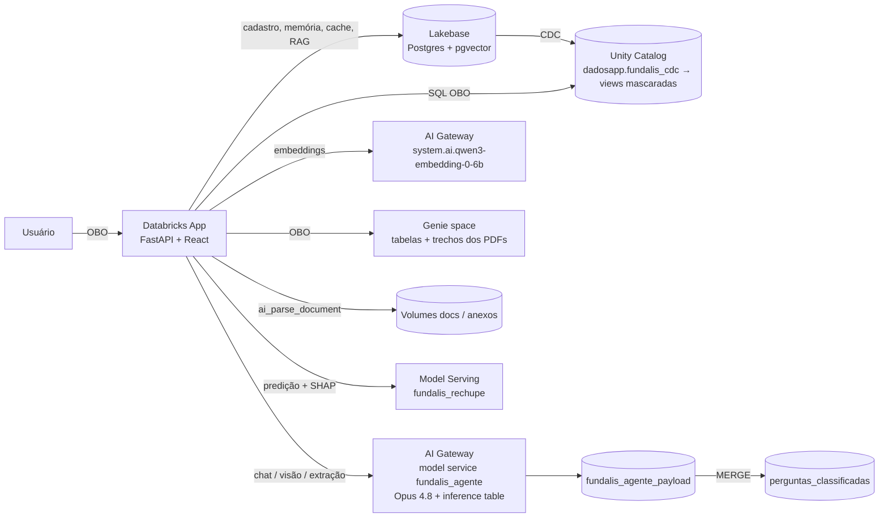

# Fundalis IA

Demo de um app de IA para uma **fundição fictícia** (blocos de motor, cabeçotes, peças estruturais e usinagem),
rodando em **Databricks Apps** com Lakebase, Unity Catalog, AI Gateway, Genie e Model Serving.

> **Tudo é fictício.** A empresa Fundalis, clientes, leads, vendas, plantas, PDFs e o dataset de treino do modelo
> de rechupe foram gerados para a demo. E-mails usam o domínio reservado `.example`, telefones usam DDD `00` e
> CPFs/CNPJs têm dígitos verificadores inválidos de propósito.

## O que o app faz

| Aba | O que mostra |
|---|---|
| **Painel** | KPIs, mapa de vendas, distribuições e leads priorizados — consultas *on-behalf-of* do usuário, com PII mascarada pelo Unity Catalog |
| **Cadastro** | CRUD de leads no **Lakebase (Postgres)**, cadastro a partir de PDF (`ai_parse_document` + LLM, prompt versionado e editável), anexos; replicação **Lakebase → Unity Catalog por CDC** com view mascarada |
| **Peças** | Inspeção de foto de peça fundida (visão do Opus 4.8) |
| **Rechupe** | Texto livre → parâmetros extraídos pela IA (editáveis) → modelo de ML servido; explicabilidade **SHAP** (local + global) e explicação textual |
| **Documentos** | Base de conhecimento: upload → Volume UC → `ai_parse_document` → trechos (Delta, usados pelo Genie) + embeddings (pgvector no Lakebase) |
| **Agente** | Chat com guardrails (Opus 4.8 via AI Gateway), cache semântico e RAG no Lakebase, Genie (tabelas + PDFs); orquestrado em **LangGraph** |
| **Assuntos** | Perguntas lidas da **inference table** do AI Gateway, classificadas por assunto pelo guardrail e agrupadas em clusters |

## Arquitetura



### Agente (LangGraph — `app/agente.py`)


`genie` e `rag` rodam em paralelo. Os passos são emitidos ao vivo com `get_stream_writer()` e o app expõe o
Mermaid gerado pelo próprio grafo em `GET /api/agente/grafo` e o código em `GET /api/agente/codigo`.

## Estrutura

```
app/                 Databricks App (FastAPI + React/htm sem build)
  app.py             backend (APIs, Lakebase, AI Gateway, Genie, CDC, documentos, rechupe)
  agente.py          agente em LangGraph
  app.yaml           comando e variáveis (APP_*); recursos do app: sql-warehouse, lakebase, genie-space, rechupe
  static/            front-end (index.html, app.js, logos SVG, vendor/: React, htm, Mermaid)
notebooks/
  10_rechupe_model.py  gera dados sintéticos, treina GradientBoosting, calcula SHAP, registra no UC
scripts/             helpers de setup (SQL no warehouse, Postgres no Lakebase, Genie, seeds, PDFs fictícios)
pdfs/                PDFs fictícios (base de conhecimento e fichas de cadastro)
```

## Como recriar

Pré-requisitos: Databricks CLI autenticado, um SQL warehouse, permissão para criar catálogo/schemas, Lakebase,
model services no AI Gateway, Model Serving e Apps. Copie `.env.example` para `.env` e exporte as variáveis
(`set -a; source .env; set +a`).

1. **Unity Catalog** — crie o catálogo `dadosapp` e os schemas `fundalis_ia` e `fundalis_cdc`; rode
   `python3 scripts/sql.py -f scripts/seed_uc_1.sql`, `seed_uc_2.sql` e `gov.sql` (tabelas, funções de máscara
   `mask_*`/`pii_liberado`, volumes `docs` e `anexos`).
2. **Lakebase** — crie o projeto `fundalis-ia`, rode `python3 scripts/pg.py -f scripts/ddl_lakebase.sql`
   (schemas `cadastro` e `agente`, pgvector/HNSW) e `python3 scripts/seed_leads.py`.
3. **CDC** — `databricks postgres create-cdf-config <database> dadosapp fundalis_cdc cadastro --cdf-config-id cadastro_cdc`
   (as tabelas precisam de `REPLICA IDENTITY FULL`); depois `scripts/views.sql` cria as views mascaradas
   `leads`/`leads_anexos` e a função `buscar_documentos`.
4. **AI Gateway** — crie o model service `dadosapp.fundalis_ia.fundalis_agente` (destino Claude Opus 4.8) com
   inference table no schema `dadosapp.fundalis_ia` (prefixo `fundalis_agente`).
5. **Documentos** — envie os PDFs de `pdfs/` pela aba Documentos (ou para o Volume `docs`).
6. **Genie** — `python3 scripts/cria_genie.py`.
7. **Modelo de rechupe** — rode `notebooks/10_rechupe_model.py` (serverless) e crie o endpoint `fundalis_rechupe`
   servindo `dadosapp.fundalis_ia.rechupe_model`.
8. **App** — crie o app `fundalis-ia` com os recursos de `app.yaml`, aplique `scripts/grants_sp.sql` ao service
   principal do app (`APP_SP_CLIENT_ID`) e faça o deploy:
   ```bash
   databricks sync app /Workspace/Users/<voce>/fundalis_ia/app
   databricks apps deploy fundalis-ia --source-code-path /Workspace/Users/<voce>/fundalis_ia/app
   ```
9. **Service policies (opcional)** — em *AI Gateway → fundalis_agente → Policies*, crie guardrails
   *LLM-as-a-judge* de entrada e saída (a criação é só pela UI). O app reconhece bloqueios de policy
   (`databricks_service_policy`) e mostra o passo em vermelho no chat.

## Notas

- Guardrails em duas camadas: prompts de guardrail no Opus 4.8 (entrada e saída, registrados na inference table)
  e, opcionalmente, service policies do AI Gateway.
- O cache semântico é separado por escopo de acesso a PII, para que quem não vê PII nunca receba uma resposta
  gerada para quem vê.
- Máscaras de PII ficam em views dinâmicas (column mask direto na tabela de CDC quebra o writer do CDC).
- Chamadas a modelos passam sempre pelo AI Gateway (`/ai-gateway/mlflow/v1/...`); endpoints pay-per-token
  chamados direto podem estar desabilitados no workspace.
