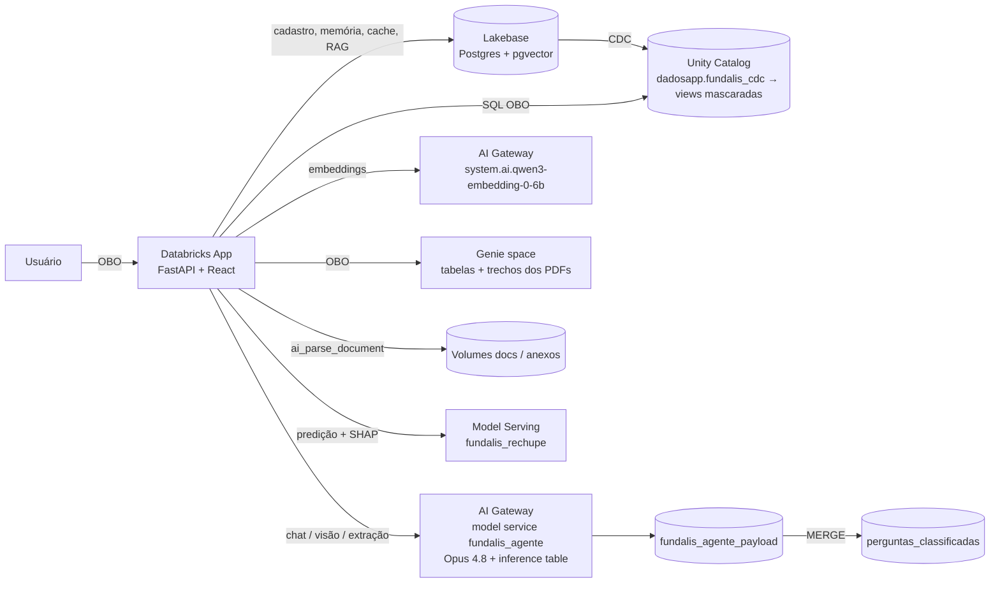
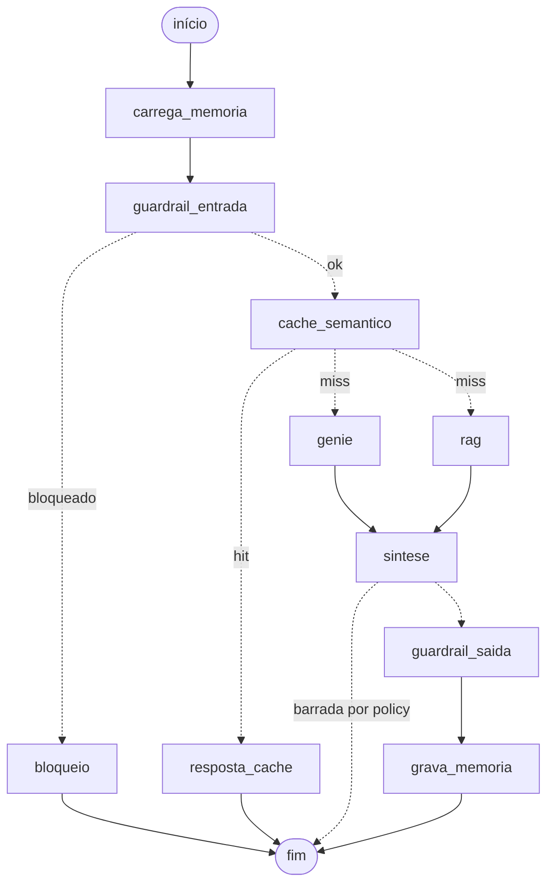

# Fundalis IA

Demo de um app de IA para uma **fundição fictícia** (blocos de motor, cabeçotes, peças estruturais e usinagem),
rodando em **Databricks Apps** com Lakebase, Unity Catalog, AI Gateway, Genie e Model Serving.

> **Tudo é fictício.** A empresa Fundalis, clientes, leads, vendas, plantas, PDFs e o dataset de treino do modelo
> de rechupe foram gerados para a demo. E-mails usam o domínio reservado `.example`, telefones usam DDD `00` e
> CPFs/CNPJs têm dígitos verificadores inválidos de propósito.

## O que o app faz

| Aba | O que mostra |
|---|---|
| **Painel** | KPIs, mapa de vendas, distribuições e leads priorizados — consultas *on-behalf-of* do usuário, com PII mascarada pelo Unity Catalog |
| **Cadastro** | CRUD de leads no **Lakebase (Postgres)**, cadastro a partir de PDF (`ai_parse_document` + LLM, prompt versionado e editável), anexos; replicação **Lakebase → Unity Catalog por CDC** com view mascarada |
| **Peças** | Inspeção de foto de peça fundida (visão do Opus 4.8) |
| **Rechupe** | Texto livre → parâmetros extraídos pela IA (editáveis) → modelo de ML servido; explicabilidade **SHAP** (local + global) e explicação textual |
| **Documentos** | Base de conhecimento: upload → Volume UC → `ai_parse_document` → trechos (Delta, usados pelo Genie) + embeddings (pgvector no Lakebase) |
| **Agente** | Chat com guardrails (Opus 4.8 via AI Gateway), cache semântico e RAG no Lakebase, Genie (tabelas + PDFs); orquestrado em **LangGraph** |
| **Assuntos** | Perguntas lidas da **inference table** do AI Gateway, classificadas por assunto pelo guardrail e agrupadas em clusters |

## Arquitetura



### Agente (LangGraph — `app/agente.py`)



`genie` e `rag` rodam em paralelo. Os passos são emitidos ao vivo com `get_stream_writer()` e o app expõe o
Mermaid gerado pelo próprio grafo em `GET /api/agente/grafo` e o código em `GET /api/agente/codigo`.

## Estrutura

```
bootstrap.py         cria tudo num workspace a partir de config.env (idempotente)
config.example.env   modelo do único arquivo de configuração
COMO_FOI_CONSTRUIDO.md  como a IA foi usada no build
evidencias/          saídas reais das execuções (logs, relatórios, JSON) — ver evidencias/README.md
app/                 Databricks App (FastAPI + React/htm sem build)
  app.py             backend (APIs, Lakebase, AI Gateway, Genie, CDC, documentos, rechupe)
  agente.py          agente em LangGraph
  app.yaml           comando e variáveis (APP_*); recursos do app: sql-warehouse, lakebase, genie-space, rechupe
  static/            front-end (index.html, app.js, logos SVG, vendor/: React, htm, Mermaid)
notebooks/
  10_rechupe_model.py  gera dados sintéticos, treina GradientBoosting, calcula SHAP, registra no UC
scripts/             SQL e seeds aplicados pelo bootstrap, Genie, PDFs fictícios e scripts de evidência
pdfs/                PDFs fictícios (base de conhecimento e fichas de cadastro)
```

## Como recriar num workspace novo

Tudo é criado por **um comando**, a partir de **um arquivo de configuração**. Nenhum segredo fica em arquivo: a
autenticação é a do perfil do Databricks CLI.

```bash
databricks auth login --host https://<seu-workspace>.cloud.databricks.com --profile meu-perfil
pip install databricks-sdk "psycopg[binary]"
cp config.example.env config.env      # ajuste o perfil e, se quiser, os nomes
python3 bootstrap.py                  # ~30–45 min na primeira vez
```

O `bootstrap.py` é **idempotente**: verifica o que já existe e só cria o que falta, então pode ser rodado de novo
(ou só algumas etapas: `python3 bootstrap.py --etapas app,docs`; `--listar` mostra todas).

| etapa | o que faz |
|---|---|
| `preflight` | confere autenticação, escolhe um SQL warehouse serverless (se `WAREHOUSE_ID` vazio) e checa se os modelos existem no AI Gateway |
| `uc` | catálogo, schemas, tabelas de demonstração, máscaras de PII, tabelas de documentos/assuntos e volumes |
| `lakebase` | projeto Lakebase, DDL (`cadastro.*`, `agente.*` + pgvector/HNSW) e 400 leads fictícios |
| `cdc` | CDC Lakebase → Unity Catalog e as views com PII mascarada |
| `gateway` | model service do agente (Opus 4.8) no AI Gateway com inference table |
| `modelo` | treina o modelo de rechupe (notebook serverless), registra no UC e cria o endpoint de serving |
| `genie` | Genie space com as tabelas, os trechos dos PDFs e a função de busca nos documentos |
| `app` | cria o Databricks App, liga os recursos, dá as permissões ao service principal (UC + Postgres + Lakebase), gera o `app.yaml` a partir do config e faz o deploy |
| `docs` | envia os PDFs da base de conhecimento pelo próprio app (`ai_parse_document` → Delta + pgvector) |
| `teste` | smoke test: painel, agente (Genie/RAG), guardrail e rechupe |

Os ids gerados no workspace (host do Lakebase, service principal do app, id do Genie, URL do app…) são descobertos
pelo bootstrap e gravados em `.build/estado.json` e em `.env` — que os scripts de evidência leem. Os arquivos SQL, o
notebook e o Genie no repositório usam os nomes padrão (`dadosapp.fundalis_ia`); o bootstrap troca pelos nomes do
`config.env` na hora de aplicar.

**Pré-requisitos do workspace** (o `preflight` acusa o que faltar): Databricks Apps, Lakebase, SQL warehouse
serverless, jobs serverless, AI Gateway com model services (Beta) e o modelo configurado (padrão Claude Opus 4.8)
disponível na região, `ai_parse_document`, Genie e permissão para criar o catálogo (ou um catálogo existente onde
você possa criar schemas; use `CATALOG_STORAGE_ROOT` se o metastore exigir local de armazenamento).

**Única etapa manual — service policies do AI Gateway (opcional).** A criação é só pela UI: *AI Gateway →
`<AGENT_SERVICE_NAME>` → Policies → New policy* (Custom · LLM-as-a-judge), uma de entrada e uma de saída. O app já
reconhece bloqueios de policy (`databricks_service_policy`) e mostra o passo em vermelho no chat.

## Evidências de execução e processo de build

- [`evidencias/`](evidencias/README.md) — **saídas reais** das execuções, com índice do que cada arquivo comprova:
  log completo do `bootstrap.py` criando tudo do zero ([`bootstrap_execucao.log`](evidencias/bootstrap_execucao.log)),
  o app publicado respondendo ([`EVIDENCIAS.md`](evidencias/EVIDENCIAS.md)), as consultas do agente rastreadas no
  Genie, no Query History do warehouse e na inference table ([`QUERIES.md`](evidencias/QUERIES.md)) e as métricas do
  modelo de rechupe ([`RECHUPE.md`](evidencias/RECHUPE.md)). Cada relatório tem o JSON bruto ao lado.
- [`COMO_FOI_CONSTRUIDO.md`](COMO_FOI_CONSTRUIDO.md) — como a IA (Claude Code) foi usada durante o build: divisão de
  papéis, método, linha do tempo, problemas achados nos testes, limites e governança.

## Notas

- Guardrails em duas camadas: prompts de guardrail no Opus 4.8 (entrada e saída, registrados na inference table)
  e, opcionalmente, service policies do AI Gateway.
- O cache semântico é separado por escopo de acesso a PII, para que quem não vê PII nunca receba uma resposta
  gerada para quem vê.
- Máscaras de PII ficam em views dinâmicas (column mask direto na tabela de CDC quebra o writer do CDC).
- Chamadas a modelos passam sempre pelo AI Gateway (`/ai-gateway/mlflow/v1/...`); endpoints pay-per-token
  chamados direto podem estar desabilitados no workspace.
